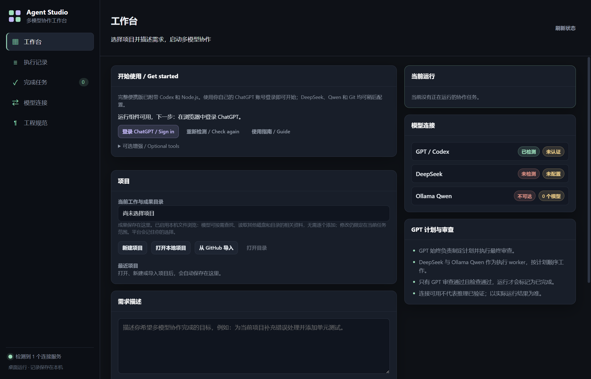
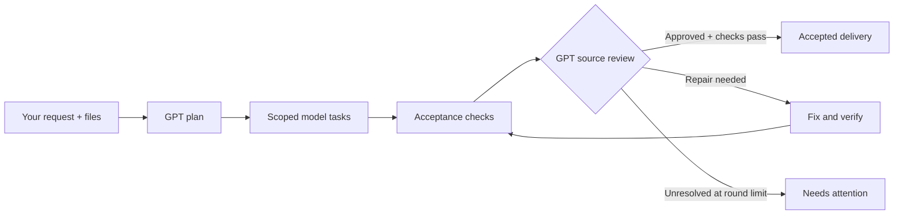
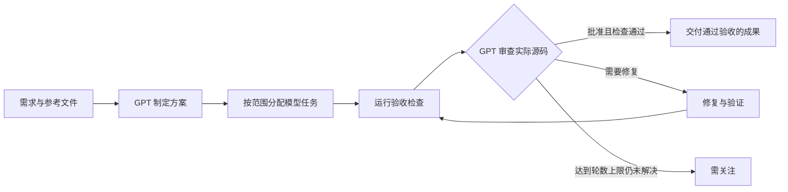

<div align="center">

# Agent Studio

### One brief. Multiple models. Evidence behind every delivery.
### 一个需求，多模型协作，每次交付有据可查。

A Windows desktop workbench where GPT plans and reviews, DeepSeek builds, and local Qwen helps analyze.

让 GPT 统筹与验收、DeepSeek 实现、本地 Qwen 辅助分析的 Windows 多模型协作工作台。


[English](#english) · [简体中文](#简体中文) · [Quick start / 快速开始](#quick-start) · [Engineering / 工程约定](docs/ENGINEERING.md)

**[Download Windows portable / 下载 Windows 便携版](https://github.com/zhangsiyu1266/agent-studio/releases/latest)** · **[Start here / 首次使用指南](docs/GETTING-STARTED.md)**

</div>



*Actual desktop interface in an isolated profile; no model execution has started. / 隔离配置下的真实桌面界面，尚未启动模型执行。*

---

## English

**Give the workbench a task. Follow the plan, inspect the changes, and see why the result passed.**

Agent Studio brings model delegation and delivery evidence into one desktop workflow. It works on real files on your computer: GPT owns the plan and final acceptance, DeepSeek handles implementation, and an optional local Qwen model supports read-only analysis. Plans, handoffs, checks, reviews, changes, and outcomes stay available for inspection.

### Why Agent Studio?

- **Different models, clear responsibilities.** Assign routine implementation to DeepSeek, focused analysis to local Qwen, and difficult work to GPT.
- **Completion has a gate.** GPT reviews actual source and evidence. Failed checks or unresolved critical/major findings prevent acceptance.
- **Work with the files you already have.** Open a local project, create a new one, or import a GitHub repository. GPT and DeepSeek can locate relevant reference files across accessible local disks.
- **See the work as it happens.** Follow planning, execution, checks, review, and delivery, with task dependencies, handoffs, logs, and recorded call durations.
- **Keep the outcome and its evidence together.** Browse accepted results, inspect changed files, open the output folder, or export a Markdown report.
- **Stop without losing existing edits.** Cancellation terminates descendant processes and preserves work already written. Interrupted runs can be retried against the current code.

### Meet the team

| Role | Model | Connection |
|---|---|---|
| Technical lead | GPT: plans, assigns, solves difficult problems, reviews and accepts | Installed Codex CLI with your existing ChatGPT login |
| Implementation worker | DeepSeek: writes code and runs relevant checks | Installed Claude Code with your existing DeepSeek configuration |
| Analysis assistant | Qwen: extracts, classifies, organizes and advises; read-only | Local Ollama, default model `qwen3:8b` |

The workbench reuses existing provider installations and authentication. GPT access requires ChatGPT login; the platform rejects API-key authentication for GPT and does not automatically switch to API billing. DeepSeek usage follows your existing provider arrangement.

### From request to accepted result



Version 1 runs one request at a time and executes worker tasks sequentially. GPT can repair issues directly or assign repair tasks. A blocked task pauses the run with an explanation; reaching the review limit preserves the work and marks it as needing attention.

<a id="quick-start"></a>

### Quick start

**For desktop users:** download `Agent-Studio-0.2.0-win-x64.zip` from [Releases](https://github.com/zhangsiyu1266/agent-studio/releases/latest), fully extract it, and open **Agent Studio.exe**. Node.js/npm, Codex and GitHub CLI are included. Click **登录 ChatGPT / Sign in** and authorize your own account in the browser. Without optional workers, GPT handles planning, implementation and final review. See the [first-run guide](docs/GETTING-STARTED.md).

The portable build targets **Windows 10/11 x64**, is not code-signed, and includes no shared account or model credits. Project-specific tools such as Git, Python and compilers may still be required.

**For source contributors:**

The desktop interface is currently primarily Chinese; the sign-in card and documentation include English guidance.

**Prerequisites**

- Windows and Node.js **24 or newer**, with npm.
- Codex CLI installed and logged in with ChatGPT.
- Optional: Claude Code configured to use DeepSeek for delegated implementation. GPT can implement tasks without it.
- Optional: Ollama with a local Qwen model for read-only support.
- Git for repository imports; GitHub CLI for GitHub account login and private-repository access.

From the project directory:

```powershell
git clone https://github.com/zhangsiyu1266/agent-studio.git
cd agent-studio
npm ci
npm start
```

You can also use `启动协作平台.cmd` after installing dependencies.

1. Open **Model connections** and check the detected providers.
2. Open or create a project, or choose **Import from GitHub**.
3. Describe the desired outcome and add any reference files or screenshots.
4. Start the run. Follow progress and inspect checks, reviews, and changes.
5. Find accepted work on the **Completed** page, open its folder, or export its report.

A detected executable or a listed model is not proof of successful inference. Real execution errors are surfaced in the run.

### Try a concrete request

> Inspect this project, identify why startup fails, fix the underlying issue, and run the relevant tests. Explain the changes and any remaining limitations.

> Build a small command-line tool in this project that summarizes a CSV file. Validate input errors, add behavioral tests, and document how to run it.

> Use the source files in the reference directory to write an integration guide in the selected output folder. Verify examples against the actual implementation.

The selected project is the work/output directory. Reference sources can live elsewhere. To change an existing application's source, select that source directory as your project.

### Files, screenshots and project import

| Capability | What you get |
|---|---|
| Projects | Recent projects, new folders, local project selection and GitHub import |
| GitHub | Public repository cloning; official device login and accessible repository listing for private imports; progress and cancellation |
| Attachments | Text, code, images, PDF, DOCX, XLSX and PPTX; select files, drag and drop, or paste screenshots |
| Limits | Up to 8 attachments, 10 MB each and 40 MB total |
| Stable references | Attachments are copied locally and retained with the run; retries use those copies |
| Delivery evidence | Task contracts, handoffs, checks, review history, change lists, timing, returned usage and exported Markdown reports |

Text excerpts are supplied directly. Image and binary-document reading depends on the tools available to GPT; attaching a format does not guarantee it can be parsed. Qwen receives supplied text and evidence, with no filesystem or terminal tools.

### Local files, clear data boundaries

- The desktop app stores run records and reports locally under the user application data directory, in `Agent Studio/workspace`.
- **GPT and DeepSeek are cloud providers. Requirements, attachments and relevant source content may be sent to them. Local storage does not mean offline inference.** Qwen defaults to local Ollama at `http://127.0.0.1:11434`.
- The platform does not copy Codex credentials into its settings. GitHub CLI manages GitHub credentials; the app does not request a personal access token.
- Existing OS permissions and provider sandbox/approval rules still apply. Worker write scopes are task instructions plus project-local checks, not whole-machine write isolation.
- Existing edits are preserved. Git patches may include changes from before the run; the UI discloses this, while run change lists compare pre-execution file hashes.

### Current scope and performance

Agent Studio is in early development. Its focus is **explicit model delegation and verifiable delivery**.

- Worker tasks run serially; automatic worktree isolation and parallel scheduling are not implemented.
- GPT calls currently use ephemeral `codex exec` sessions. Retrying starts a fresh workflow against current files; it does not resume a persistent conversation. Mid-run user steering is not available.
- There is no integrated terminal, browser workspace, plugin manager or task scheduler in the app.
- **Lower GPT usage is a possibility, not a measured guarantee.** Planning, handoffs and review add overhead. Total model tokens and elapsed time may increase, especially for small tasks. No controlled same-task Codex baseline has established a savings percentage.
- Returned usage is not your remaining subscription allowance. Cached input is included in input tokens; tokens from different providers are not a direct cost comparison.

See the dated [performance record](docs/PERFORMANCE-2026-10-13.md), [file-access acceptance](docs/FILE-ACCESS-2026-10-14.md) and [validation history](docs/VALIDATION.md) for evidence and limitations. These are historical results, not a claim that every current environment has been verified.

### Develop and package

```powershell
npm test
npm run check
npm run smoke
```

Unit tests use fixtures for behavioral verification; fixture output is not real model inference. Real provider checks are opt-in:

```powershell
node scripts/smoke.cjs --live
node scripts/pipeline-smoke.cjs
node scripts/performance-smoke.cjs
node scripts/file-access-smoke.cjs
```

Live checks consume provider usage and create isolated acceptance projects under `.build/`.

To build the Windows portable folder:

```powershell
powershell -File scripts/prepare-github.ps1
powershell -File scripts/prepare-runtime.ps1
npm run package
npm run release:smoke
npm run release:archive
```

The preparation scripts verify GitHub CLI **2.102.0** against its SHA-256, Node.js **24.21.0** against the official checksum, and Codex **0.160.0** against npm SHA-512 integrity. Their licenses and upstream resources are preserved. Packaging creates a new `dist/Agent-Studio-0.2.0-win-x64` folder; an existing folder is never silently reused. Clean-profile smoke checks hide host tool installations and credentials, and do not start OAuth or model inference. The archive command produces a ZIP and `SHA256SUMS.txt`. Generated dependencies, acceptance data and builds are excluded from the source repository.

| Directory | Purpose |
|---|---|
| `src/core/` | Orchestration, providers, process control, project state, file context and attachments |
| `src/renderer/` | Browser JavaScript, HTML and CSS for the desktop interface |
| `src/main.cjs`, `src/preload.cjs` | Electron host and IPC bridge; main-process handlers validate payloads |
| `tests/` | Node behavioral tests |
| `scripts/` | Static checks, smoke tests and packaging |
| `docs/` | Engineering contract and dated validation records |

Read [AGENTS.md](AGENTS.md) and [docs/ENGINEERING.md](docs/ENGINEERING.md) before contributing. Bug reports are most useful with reproduction steps and redacted errors; never include credentials or private source you do not intend to share.

**License:** [MIT](LICENSE). Bundled third-party components retain their own licenses; see [third-party notices](THIRD-PARTY-NOTICES.md).

---

## 简体中文

**把需求交给工作台，看清分工与修改，也看清成果为什么通过验收。**

Agent Studio 把模型分工和交付证据放进同一个桌面工作流。它直接处理你电脑上的真实文件：GPT 负责方案与最终验收，DeepSeek 承担实现，可选的本地 Qwen 提供只读分析。计划、交接、检查、审查、变更和成果都有记录可查。

### 为什么使用 Agent Studio？

- **模型各司其职。** 常规实现交给 DeepSeek，聚焦分析交给本地 Qwen，疑难工作交给 GPT。
- **完成有验收门槛。** GPT 审查实际源码与证据；检查失败或仍有未解决的严重、主要问题，就不能通过验收。
- **接着你的现有项目工作。** 打开本地项目、新建项目或从 GitHub 导入；GPT 和 DeepSeek 可按需查找可访问磁盘中的参考文件。
- **执行过程看得见。** 规划、执行、检查、审查、交付分阶段展示，同时查看依赖、交接、日志和实际调用耗时。
- **成果和依据一起保留。** 浏览通过验收的成果，查看变更文件、打开输出目录或导出 Markdown 报告。
- **停止后保留已做的工作。** 取消会终止后代进程，保留已经写入的修改；中断后可基于当前代码重新执行。

### 认识你的协作团队

| 角色 | 模型与职责 | 接入方式 |
|---|---|---|
| 技术负责人 | GPT：规划、分工、处理疑难、审查和最终验收 | 本机 Codex CLI，复用现有 ChatGPT 登录 |
| 实现工作者 | DeepSeek：编写代码并运行相关检查 | 本机 Claude Code，复用已有 DeepSeek 配置 |
| 分析助手 | Qwen：提取、分类、整理和建议，只读运行 | 本地 Ollama，默认模型 `qwen3:8b` |

工作台沿用已有模型工具和认证。GPT 必须使用 ChatGPT 登录；平台拒绝 GPT 的 API-key 认证，不会自动切换到 API 计费。DeepSeek 用量按你已有的服务配置计算。

### 从需求到通过验收



首版同时运行一个需求，内部工作者依次执行。GPT 可直接修复问题，也可分配修复任务。任务受阻时会解释原因并暂停；达到审查轮数上限仍未解决时，保留修改并标记为“需关注”。

### 快速开始

**桌面用户：** 在 [Releases](https://github.com/zhangsiyu1266/agent-studio/releases/latest) 下载 `Agent-Studio-0.2.0-win-x64.zip`，完整解压后双击 **Agent Studio.exe**。便携版已附带 Node.js/npm、Codex 和 GitHub CLI；点击 **登录 ChatGPT / Sign in**，在浏览器中登录自己的账号。未配置辅助模型时，GPT 负责规划、实现和最终审查。详见[首次使用指南](docs/GETTING-STARTED.md)。

便携版面向 **Windows 10/11 x64**，当前未做代码签名，不附共享账号或模型额度；Git、Python、编译器等项目专用工具仍可能需要另行准备。

**源码开发者：**

当前桌面界面以中文为主，入门卡片和使用文档附有英文指引。

**准备环境**

- Windows，Node.js **24 或更新版本**，以及 npm。
- 已安装 Codex CLI，并使用 ChatGPT 登录。
- 可选：Claude Code 和 DeepSeek 配置；未配置时由 GPT 实现任务。
- 可选：Ollama 和本地 Qwen 模型，用于只读辅助任务。
- 导入仓库需要 Git；GitHub 账号登录和私有仓库访问需要 GitHub CLI。

在项目目录执行：

```powershell
git clone https://github.com/zhangsiyu1266/agent-studio.git
cd agent-studio
npm ci
npm start
```

安装依赖后，也可双击 `启动协作平台.cmd`。

1. 打开“模型连接”，检查已检测到的模型工具。
2. 打开或新建项目，或选择“从 GitHub 导入”。
3. 描述想要的成果，按需添加参考文件或截图。
4. 开始运行，查看过程、检查、审查和变更。
5. 在“完成任务”中查看通过验收的成果，打开目录或导出报告。

检测到可执行程序或列出模型，不代表已成功完成真实推理。实际执行错误会在任务中明确显示。

### 可以直接这样提需求

> 检查这个项目为什么启动失败，修复根本原因，运行相关测试，并说明实际修改和剩余限制。

> 在当前项目编写一个汇总 CSV 文件的命令行工具，处理输入错误、补充行为测试，并写清运行方法。

> 根据参考目录中的实际源码，在选中的成果目录编写集成指南，并核对文档示例是否符合真实实现。

选中的项目是工作与成果保存位置，参考源码可以在其他目录。要直接修改已有程序，请把该程序的源码目录选为项目。

### 文件、截图与项目导入

| 能力 | 具体支持 |
|---|---|
| 项目管理 | 最近项目、新建目录、打开本地项目、从 GitHub 导入 |
| GitHub | 克隆公开仓库；官方设备登录、列出有权访问的仓库并导入私有仓库；显示进度、支持取消 |
| 附件 | 文本、代码、图片、PDF、DOCX、XLSX、PPTX；文件选择、拖放、粘贴截图 |
| 数量与大小 | 最多 8 个附件，单个 10 MB，总计 40 MB |
| 稳定参考 | 附件保存独立副本，随执行记录保留，重试沿用副本 |
| 交付证据 | 任务约定、交接、检查、审查历史、变更、耗时、返回用量和 Markdown 报告 |

文本摘录直接提供给模型；图片和二进制文档的读取取决于 GPT 可用工具，支持添加某种附件不代表保证解析成功。Qwen 只接收提供的文本与证据，没有文件系统和终端工具。

### 本地文件与数据边界

- 桌面应用将执行记录和报告保存在本机用户应用数据目录下的 `Agent Studio/workspace`。
- **GPT 和 DeepSeek 使用云端推理，需求、附件及相关源码可能发送给对应服务。本地保存不代表离线推理。** Qwen 默认连接本地 Ollama：`http://127.0.0.1:11434`。
- 平台不把 Codex 登录凭据复制到设置中。GitHub 凭据由 GitHub CLI 管理，应用不要求填写个人访问令牌。
- 系统权限及模型工具自身的沙箱、审批规则仍然有效。工作者写入范围依靠任务约定与项目内检查，不是整台电脑级别的写入隔离。
- 已有修改会保留。Git 补丁可能包含任务开始前的未提交变更，界面会提示；本次变更清单通过执行前后的文件哈希对比生成。

### 当前范围与性能

Agent Studio 处于早期开发阶段，重点是**明确的模型分工和可验证的交付**。

- 工作者串行执行，尚无自动 worktree 隔离和并行调度。
- GPT 当前通过临时 `codex exec` 会话运行。重试会基于当前文件开启新流程，不会恢复持久对话；尚不支持执行中追加用户指令。
- 应用内尚无集成终端、浏览器工作区、插件管理器或任务调度器。
- **减少 GPT 用量是优化方向，不是已经证实的保证。** 规划、交接和审查会增加开销，尤其小任务的总 token 和耗时可能更高。目前没有同任务 Codex 对照测试证实节省比例。
- 模型返回用量不等于订阅剩余额度；缓存输入已包含在输入 token 中，不同模型的 token 数也不能直接用于费用比较。

具体证据与限制见有日期的[性能记录](docs/PERFORMANCE-2026-10-13.md)、[文件访问验收](docs/FILE-ACCESS-2026-10-14.md)和[验证历史](docs/VALIDATION.md)。这些是历史结果，不代表每个当前环境都经过同样验证。

### 开发与打包

```powershell
npm test
npm run check
npm run smoke
```

单元测试使用夹具验证行为，夹具输出不是真实模型推理。真实模型验收需主动执行：

```powershell
node scripts/smoke.cjs --live
node scripts/pipeline-smoke.cjs
node scripts/performance-smoke.cjs
node scripts/file-access-smoke.cjs
```

真实验收会消耗模型用量，并在 `.build/` 下创建隔离的验收项目。

构建 Windows 便携版：

```powershell
powershell -File scripts/prepare-github.ps1
powershell -File scripts/prepare-runtime.ps1
npm run package
npm run release:smoke
npm run release:archive
```

准备脚本分别验证 GitHub CLI **2.102.0** 的 SHA-256、Node.js **24.21.0** 的官方校验值和 Codex **0.160.0** 的 npm SHA-512 完整性，并保留许可证和上游运行资源。打包会新建 `dist/Agent-Studio-0.2.0-win-x64`，不会静默复用旧目录。干净配置冒烟验收隐藏本机已有工具和凭据，不启动 OAuth 或模型推理；归档命令生成 ZIP 与 `SHA256SUMS.txt`。依赖、验收数据和构建产物不纳入源码仓库。

| 目录 | 用途 |
|---|---|
| `src/core/` | 编排、模型接入、进程控制、项目状态、文件上下文和附件 |
| `src/renderer/` | 桌面界面的浏览器 JavaScript、HTML 和 CSS |
| `src/main.cjs`、`src/preload.cjs` | Electron 主进程与 IPC 桥接，主进程处理器负责参数校验 |
| `tests/` | Node 行为测试 |
| `scripts/` | 静态检查、冒烟验收和打包 |
| `docs/` | 工程约定及有日期的验证记录 |

贡献前请阅读 [AGENTS.md](AGENTS.md) 和 [docs/ENGINEERING.md](docs/ENGINEERING.md)。报告问题时请提供复现步骤和脱敏后的错误信息，不要上传凭据或不打算公开的私有源码。

**许可证：** [MIT](LICENSE)。随包分发的第三方组件保留各自许可证，详见[第三方声明](THIRD-PARTY-NOTICES.md)。
